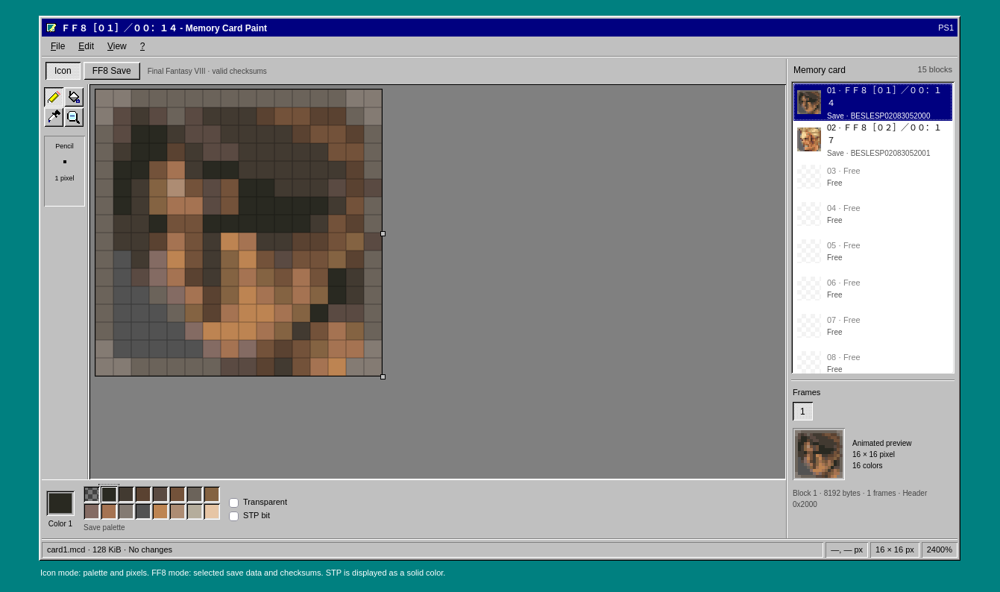
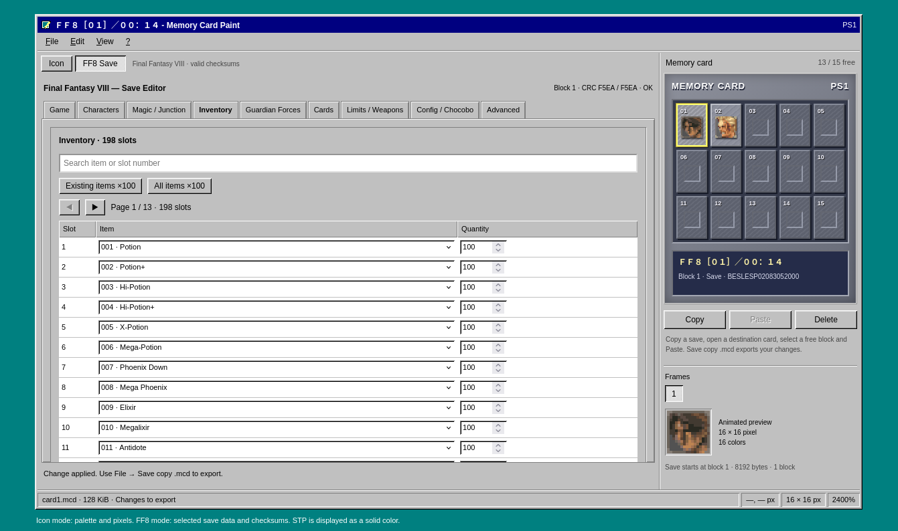

Made with **Codex GPT-Sol**.

# Memory Card Paint

An HTML/JavaScript editor for PlayStation memory cards, with a Windows 95/98 Paint-style interface. Runs offline in your browser, with no installation required.

- Browse saves and edit their 16×16 icons using a pencil, flood fill, eyedropper, color palette and animation frames.
- Edit **Final Fantasy VIII PS1** saves: levels, EXP, weapons, inventory, magic, junctions, GFs, gil, cards and Limit Breaks.
- Includes undo/redo, an advanced hex editor and automatic FF8 checksum recalculation.
- Offers documented FF8 story references across all four discs for experimentation; applying one changes progress and optionally the disc, without teleporting the party or updating event flags.

## Preview

## Usage

1. Open [index.html](index.html) in your browser.
2. Use the **File** menu to open a raw 128 KiB memory card (`.mcd`, `.mcr` or `.bin`).
3. Select a save and edit its icon, or click **FF8 Save** to edit FF8 game data.
4. Choose **Save copy .mcd…** from the **File** menu to download the modified card. The original file remains unchanged.

## References

- [Griever — Qhimm](https://www.qhimm.com/)
- [Hyne — FF8 save editor](https://github.com/myst6re/hyne)
- [FF8/GameSaveFormat](https://wiki.ffrtt.ru/index.php/FF8/GameSaveFormat)
- [PSX-SPX — memory card format](https://psx-spx.consoledev.net/ps1/sio/controllersandmemorycards/memory-card-data-format/)
